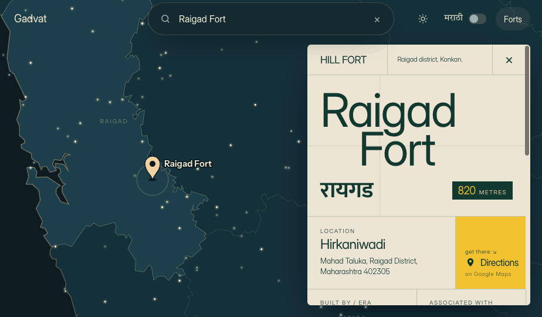

# Gadvat · गडवाट

An open, interactive atlas of the forts of Maharashtra — hill forts, sea forts, coastal and land forts — on one map, in English and Marathi.

**Live site → [doublepoetry.github.io/Gadvat](https://doublepoetry.github.io/Gadvat/)**

<!-- Add a screenshot: upload screenshot.png to the repo root, then keep this line -->


## What's here

- 267 forts with type, district, region, coordinates and notes
- Marathi names throughout
- Directions on Google Maps and a history link for every fort
- Light and dark modes

## Help make it better

Gadvat is maintained by one person and grows through contributions. You can add:

- **Facts & history** — who built it, key events, people associated with it (with sources)
- **Routes** — trek routes, base villages, time to the top, season (with the date you did it)
- **Maps** — fort layout sketches, plans, GPX tracks
- **Photos** — your own, with a caption
- **Fixes** — wrong location, spelling, Marathi name, fort type

Read **[CONTRIBUTING.md](CONTRIBUTING.md)**, then open a pull request or [an issue](../../issues/new/choose). Every change is reviewed before it goes live.

## Repository layout

```
index.html            the site
support.js            site runtime (don't edit)
data/forts.json       all forts — the main dataset
data/districts.json   district map shapes
data/addresses.json   cached nearest-village addresses
content/<fort-id>/    history, routes, maps, photos per fort
```

## Licence

- Code: [MIT](LICENSE)
- Data and content (`data/`, `content/`): [CC BY-SA 4.0](CONTENT-LICENSE.md)
